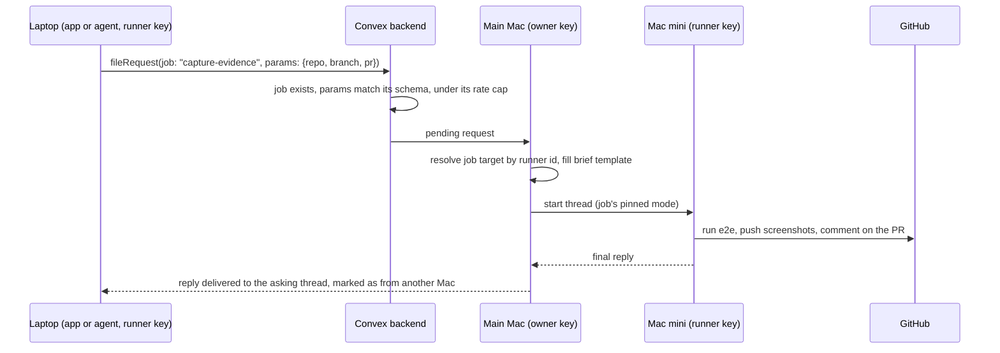

# Multi-Mac dispatch: the laptop sees every Mac and runs named jobs on the Mac mini

- **Status:** proposed (2026-11-26). Tracker: none yet (Linear was not authorized in the session that wrote this).
- **ADRs:** [cross-Mac work from a runner-key Mac runs as owner-defined named jobs](../adr/0001-cross-mac-work-from-a-runner-key-mac-runs-as-named-jobs.md), [runner keys may hold an opt-in read tier](../adr/0002-runner-keys-may-hold-an-opt-in-read-tier.md).

## Summary (one minute)

A Mac on a runner key (a laptop) today sees only its own threads and can start work on another Mac only
through a card someone approves in the main Mac's app. This design lets it see every Mac's threads
(an opt-in, read-only tier on its key) and start **named jobs** on the Mac mini with no approval: the
owner defines each job on the main Mac (target Mac, repos, parameters, access mode, brief template), and
the main Mac starts a matching request by itself. Free-text requests still need a human, now also from
the phone. The started thread's reply comes back to the asking thread on the laptop.



## What changes

| Thing | Today | After |
| --- | --- | --- |
| Laptop sidebar | Its own threads only | Every Mac's threads, with the read tier on its key |
| "Runs on" on the laptop's new-thread box | Absent | Lists Macs; offers jobs, and free text that waits for approval |
| Laptop agent asks for work on the mini | Card on the main Mac, approved in its app | A named job starts by itself; free text waits for approval |
| Who can approve a free-text request | Main Mac's app only | Main Mac's app or the paired phone |
| Reply from a thread the laptop asked for | Only if that thread messages back itself | Passed back to the asking thread by the main Mac |
| What a runner key may do on other Macs | Nothing | Read (opt-in) and file requests; never queue work itself |

## Decisions

| # | Decision | Why | ADR |
| --- | --- | --- | --- |
| 1 | A runner key never gains the power to queue work on another Mac; it files requests the main Mac carries out | The key is a file that Full-access agents on that Mac can read, so any power on it is the agents' power | 0001 (new) |
| 2 | Unattended starts only for owner-defined named jobs with typed parameters; free text always needs a human | A rule on metadata (runner, folder) lets an injected brief run unreviewed | 0001 (new) |
| 3 | Jobs are written on the main Mac and published to Convex with the owner key; runner keys only read them | The laptop must not be able to change what runs unattended | 0001 (new) |
| 4 | Each job pins its access mode and a rate cap; a job never gets Full by leaving the mode out | A relay create with no mode is Full today (`convex/relay.ts:317`) | 0001 (new) |
| 5 | The read tier is a per-key flag with a fixed allowlist of read functions; tool output, accounts and pools stay owner-only | All runner keys are equal today; a blanket tier would reach the mini's and cloud keys too | 0002 (new) |
| 6 | The phone may approve a free-text request; the main Mac re-checks the filed row's fingerprint before starting | A phone token can already start threads on any Mac, so this adds no power | — |
| 7 | Messaging an existing thread on another Mac from the laptop is out of v1; jobs are one-shot | It needs a new request kind, card and rule matching; one-shot jobs cover the use case | — |
| 8 | Release: each PR behind an experiment switch (`docs/experiments.md`), off by default | The gates are security-relevant; the owner turns them on per Mac | — |
| 9 | Proposed upstream to mikecann/threadbear before merging in the fork | Upstream edited `convex/runnerAccess.ts` 38 times in the month to 26 Nov 2026; a fork-only key model conflicts at every update | — |

## Layers

| # | What it builds | Criteria | Risk | Depends on |
| --- | --- | --- | --- | --- |
| 1 | Jobs contract: `jobs` table (owner writes, runner keys read), `fileRequest` takes `job` + `params`, backend validation and rate cap | AC1, AC2, AC7 | 🔴 High | — |
| 2 | Main Mac job starter: owner query of pending requests, auto-start of valid job requests by runner id with the pinned mode and an honest first line | AC3, AC4, AC5, AC6 | 🔴 High | 1 |
| 3 | Replies back: far-reports watches request-started threads and delivers each final reply to the asking runner's thread | AC8 | 🟡 Medium | 2 |
| 4 | Phone approval of free-text requests through the main Mac | AC9 | 🟡 Medium | 2 |
| 5 | Read tier: per-key flag, allowlisted reads, laptop sidebar and Runs on (jobs and free text) | AC10, AC11, AC12 | 🔴 High | 1 |
| 6 | Docs: SECURITY.md, docs/protocol/keys.md, guide section on jobs; mini hardening checklist | AC13 | 🟢 Low | 1, 5 |

## Open questions

1. Should the laptop's read tier include the main Mac's threads? Default: yes (the goal is to see every Mac), recorded as an accepted risk in ADR 0002.
2. Is a browser on the laptop paired with the website? If so, a laptop agent can already read that token and start Full threads on any Mac, before any of this. Default: keep it, and say so in the docs.
3. Upstream first or fork first? Default: open the proposal upstream, build in the fork behind the switch meanwhile.

## Out of scope

Messaging existing threads on another Mac from the laptop; a GitHub Actions runner on the mini; jobs
started from GitHub events; virtual runners; changing what the owner key or the phone may do beyond decision 6.

## Failures this must protect against

- An injected agent on the laptop reads `secrets/convex-key` and files requests directly: only named jobs with valid parameters may run unattended.
- A request with no mode starting a Full-access thread on the mini.
- A job whose target is renamed, rebuilt with a new id, offline or unknown falling back to "start here" on the main Mac.
- A branch or repo parameter carrying `..`, a path, a shell metacharacter or a repo outside the job's allowlist.
- A loop of job requests draining the mini's model quota (auto-start would bypass the 5-pending cap).
- The started thread's first line claiming "allowed by the user" for a start no human saw.
- A reply from the mini (which ran branch code and read PR text) reaching a laptop thread as instructions.
- The read flag surviving `tb runner revoke` or a re-add, or reaching keys it was not given to.
- The mini's GitHub token being able to push to default branches or workflows that the main Mac or CI then runs.

## Acceptance criteria

- [ ] **AC1** The backend refuses a runner key's request naming a job the owner has not defined (unit test).
- [ ] **AC2** The backend refuses a job request whose parameters fail the job's schema: a repo outside its allowlist, a branch with `..`, whitespace or a leading `-`, a PR that is not a positive integer (unit test).
- [ ] **AC3** The main Mac starts a valid job request on the job's target runner id with the job's pinned mode, with no card, within 60 seconds of filing (unit test, and a hand test from the M4 laptop to the Mac mini).
- [ ] **AC4** A job request whose target resolves to no runner, or to an id other than the job's, starts nothing and the request ends denied with the reason (unit test).
- [ ] **AC5** A free-text request from a runner key is never started without a human answer (unit test).
- [ ] **AC6** A job-started thread's first line names the job and the asking thread and does not say "allowed by the user" (unit test).
- [ ] **AC7** Job requests over the job's hourly cap are refused by the backend (unit test).
- [ ] **AC8** The job thread's final reply arrives in the asking thread on the laptop, marked as from another Mac (unit test, and the hand test in AC3).
- [ ] **AC9** The Android app shows Start it on a free-text request card, and starting it creates the thread on the target Mac (hand test on the phone).
- [ ] **AC10** A runner key with the read flag may call exactly the allowlisted reads; one without it is refused; `remoteBody`, `remoteAccounts` and `remotePools` are refused for both (`runner/test/unit/runner-access.test.ts`).
- [ ] **AC11** On the M4 laptop with the read flag, the sidebar lists the Mac mini's and the M5's threads and the new-thread box shows Runs on (screenshot).
- [ ] **AC12** `tb runner revoke` and a re-add with `--replace` clear the read flag (unit test).
- [ ] **AC13** SECURITY.md and docs/protocol/keys.md state what a read-flag key reaches and what a job may do (doc diff).

---

## Detail

### What a job is

Written on the main Mac (`tb job add`, or Settings > Runners > Jobs), stored in a `jobs` table only the
owner key writes, readable by runner keys so the laptop can list them:

```text
name:        capture-evidence
target:      57a6cebe9e82            # runner id, never a name
repos:       [csdev19/threadbear, ...]
params:      { repo: repo, branch: branch, pr: int }
mode:        auto                     # never full by omission; full only if written
perHour:     6
brief:       "In ~/code/{repo}, check out {branch}, run the e2e suite, capture
              screenshots with cs-capture-evidence and post them on PR #{pr}."
```

The backend validates `params` against the job's typed schema at `fileRequest`. The main Mac fills the
brief from the template; the laptop supplies values, never text that becomes instructions.

### Where today's code changes

- `convex/schema.ts`: `jobs` table; `runnerRequests` gains `job` and `params`; `runnerKeys` gains `reads`.
- `convex/relay.ts`: `fileRequest` validation and rate cap; new owner query of pending requests; `decideRequest` records the job.
- `convex/runnerAccess.ts`: the `Caller` for a runner key carries `reads`; the allowlisted reads become "owner, or a key with reads".
- `runner/src/cross-runner.ts`: a watcher on the main Mac that starts job requests (`answerNow` path with the job's target id and mode) and a job header beside `askedHeader`.
- `runner/src/far-reports.ts`: `add` for request-started threads; delivery to another runner's thread through the relay.
- `convex/phone.ts` and the Android app: Start it on a request card, decided by the main Mac.
- `desktop/gpui/src/composer_chips.rs`: Runs on shown on a runner-key Mac when its key has reads; picking a job opens its parameter form.

### Mini hardening (no code)

No owner key, deploy key or Convex login (`tb runner check --ssh <mini>` from the main Mac); a
fine-grained GitHub token limited to the job repos, with no workflow scope; branch protection on each
repo's default branch, so what the mini pushes is reviewed before anything builds from it.

### Sources

- Current request flow, read functions and far-reports conditions: digest of `convex/relay.ts:587-731`,
  `runner/src/cross-runner.ts:88-365`, `runner/src/far-reports.ts`, `convex/runnerAccess.ts:255-330`.
- Weak-point passes (Sonnet high, 26 Nov 2026), kept out of git under `.session/weak-points/`.
- State of the art: deny-by-default src-to-dst rules ([Tailscale grants](https://tailscale.com/kb/1337/acl-syntax)),
  dispatch of a parameterized job as a narrower right than submitting a job
  ([Nomad ACL](https://developer.hashicorp.com/nomad/docs/secure/acl/policies)), and results returned as a
  reviewable branch or PR ([Claude Code on the web](https://code.claude.com/docs/en/claude-code-on-the-web)).
